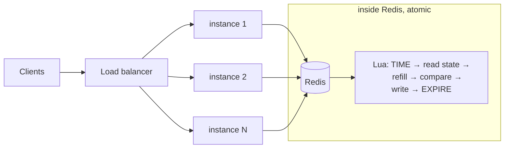

# rate-limit-service

A distributed rate limiting service. Multiple stateless instances enforce one
shared quota per tenant and resource, with rules configurable at runtime.

## What this is

An **evaluation service**, not middleware. Other services ask it for a
decision:

```
client → API gateway → [POST /v1/check] → rate-limit-service → Redis
                     ← allow / deny     ←
```

The gateway enforces; this service decides. That is why `/v1/check` returns
`200 {"allowed": false}` rather than `429` — a 429 would mean the *gateway*
is being rate limited. The response carries everything needed to build a 429
for the end user: remaining quota, reset time, retry-after.

## Quick start

```bash
docker compose up -d --build        # redis + 2 instances + nginx on :8080

curl -X PUT localhost:8080/v1/rules -H 'Content-Type: application/json' -d '{
  "identifier": "acme", "namespace": "search",
  "algorithm": "token_bucket", "capacity": 20, "refill_rate": 2
}'

curl -X POST localhost:8080/v1/check -H 'Content-Type: application/json' \
  -d '{"identifier":"acme","namespace":"search"}'
```

Requires Go 1.27+ to build locally.

## Proof of cross-instance correctness

```
$ ./scripts/prove-cross-instance.sh
rule created: capacity 20
instances in rotation:
app1
app2
allowed=20 denied=20
PASS: exactly 20 allowed across both instances
```

Forty requests through a round-robin load balancer against a capacity of 20.
Per-instance state would have allowed ~40.

## API

| | |
|---|---|
| `POST /v1/check` | evaluate and consume. Body: `identifier`, `namespace`, optional `cost` (default 1) |
| `GET /v1/quota?identifier=&namespace=` | observe without consuming |
| `PUT /v1/rules` | create or replace a rule |
| `GET /v1/rules` | list rules |
| `DELETE /v1/rules?identifier=&namespace=` | remove a rule |
| `GET /metrics` | Prometheus |
| `GET /healthz` | liveness, pings Redis |

Responses carry `X-RateLimit-Limit`, `X-RateLimit-Remaining`,
`X-RateLimit-Reset`, and `Retry-After` on denials.

## How correctness is achieved

A rate limit check is a read-modify-write on shared state. The naive
distributed version is broken:

```
instance A: GET count → 99
instance B: GET count → 99     ← Redis served this happily
instance A: 99 < 100, allow, SET 100
instance B: 99 < 100, allow, SET 100
```

101 requests served against a limit of 100. Every individual Redis command
was atomic; the *sequence* was not. Redis being single-threaded guarantees
nothing interleaves within a command, not between your commands.

The fix: the entire decision runs as a Lua script inside Redis, which
executes it to completion without interleaving. One round trip, no retry
loop, no lock.

**Time comes from `redis.call('TIME')`, not from the caller.** Refill is
`(now − last_refill) × rate`. If each instance supplied its own clock, normal
NTP drift of tens of milliseconds would make elapsed time wrong — and
negative when a slower clock follows a faster one, which would *remove*
tokens. One server clock read inside the critical section removes the problem.

## Algorithm

**Token bucket.** Chosen because the prompt asks for burst and sustained
rates to be distinguishable, and token bucket expresses them as two
independent parameters: `capacity` is the burst ceiling, `refill_rate` the
long-run average. "100 requests per minute" cannot express whether all 100
may arrive at once; `capacity: 20, refill_rate: 16.7/s` can.

Refill is **lazy** — tokens are computed on arrival from elapsed time, never
added by a background job. A ticker's cost scales with buckets that exist; in
production, tenant-namespace pairs outnumber requests per second by orders of
magnitude. It would also need leader election (otherwise N instances refill
every bucket N times), and it would prevent TTL-based eviction of idle keys.

New buckets start full, and a **missing key is indistinguishable from a full
bucket**. That equivalence is what makes TTL eviction safe: a key is expired
once the bucket would be full anyway, so it carries no information worth
keeping.

## Known limitations

1. **Only token bucket is implemented.** Sliding window and fixed window are
   designed but not built — see below.
2. **Rules are read from Redis on every evaluation** — a second round trip
   per decision. An in-process cache with a short TTL would remove it at the
   cost of a window where instances enforce different limits for the same
   tenant. The round trip is the better trade at this scale; the cache
   becomes worthwhile at high throughput.
3. **Redis is a single point of failure and the throughput ceiling.** Every
   decision touches it. Scaling past one instance means Redis Cluster with
   keys hash-slotted — which works here because every decision touches
   exactly one key, so no cross-slot operations are needed.
4. **Async replication can lose recent increments** on failover. Acceptable
   for rate limiting (a few extra requests served); unacceptable if this were
   billing.
5. **Fail-open by default.** If Redis is unreachable, requests are allowed
   and the event is logged and counted (`ratelimit_state_errors_total`). This
   prioritises availability — the limiter should not become the reason the
   product is down. Set `FAIL_OPEN=false` to invert for abuse-prevention use.
6. **Caller timeouts can double-count.** If the limiter counts a request and
   the response is lost, the caller retries and is counted again. Bounded by
   over-counting in the safe direction; an idempotency key would fix it.
7. **`/v1/quota` is advisory.** It is accurate at the instant it returns and
   stale immediately after. It is a snapshot, never a reservation.
8. **Float accumulation.** Tokens are IEEE doubles in both Go and Lua.
   Rounding error over very large request volumes is possible; storing
   milli-tokens as integers would be exact.
9. **No authentication on the config API.** Anyone who can reach
   `PUT /v1/rules` can change anyone's limits.
10. **`/healthz` couples instance health to Redis.** A Redis hiccup marks
    every instance unhealthy at once. Splitting `/livez` (shallow) from
    `/readyz` (deep) is the correct fix.

## Sliding window: designed, not implemented

Three options, with the trade-off that decided it:

**Fixed window** — one counter per `(key, window)`, incremented and expired
at the boundary. Cheapest and simplest. Broken at boundaries: a limit of 100
per minute permits 100 at 11:00:59 and another 100 at 11:01:00 — double the
intended rate across a two-second span.

**Sliding window log** — a sorted set of request timestamps; drop entries
older than the window and count what remains. Exactly correct. O(n) memory
per key, where n is the limit: a tenant with a 10,000/hour quota stores
10,000 timestamps. Does not scale.

**Sliding window counter** — keep the current and previous fixed windows and
weight the previous one by how much of it still falls inside the lookback:

```
estimate = current + previous × (1 − elapsed_fraction_of_current_window)
```

O(1) memory, no boundary doubling, approximate. The approximation assumes
requests in the previous window were evenly distributed. Clustered at its
start, the formula over-counts and denies requests it should allow; clustered
at its end, it under-counts. Error is bounded by the previous window's total.

**Would implement the counter**, with fixed window as its degenerate case —
drop the weighting term and the same keys and increments give you fixed
window, so both ship for the price of one.

## What I would do next

In rough priority order: sliding window counter; authentication on the config
API; `/livez` and `/readyz` split; an in-process rule cache with pub/sub
invalidation once throughput justifies it; Redis Cluster for horizontal state
scaling; adaptive limits driven by downstream error rate.

## Architecture



Instances are stateless and interchangeable. All evaluation state and all
rules live in Redis. The whole decision executes inside Redis as one
indivisible unit.

## Tests

```bash
docker compose up -d redis
go test ./... -race
```

- `internal/limiter` — algorithm unit tests against an injectable clock. No
  sleeping, no Redis.
- `internal/redisstore/concurrency_test.go` — 500 goroutines, one key,
  capacity 100, asserts exactly 100 allowed. Fails against a non-atomic
  implementation.
- `scripts/prove-cross-instance.sh` — end-to-end across two instances.

CI runs `go vet` and the full suite with `-race` against a Redis service
container on every push.